<p align="center">
  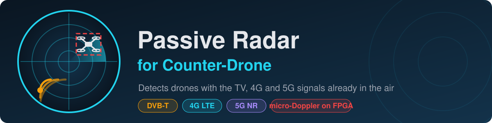
</p>

<p align="center">
  
  
  
  
  
</p>

A **passive radar** that finds small drones without transmitting anything. It listens to the **digital TV, 4G and 5G signals already in the air**. It compares each signal as it arrives straight from the tower with its faint echo off a drone, which gives range, speed and bearing. An on-board FPGA then tells **drones from birds** by their micro-Doppler: spinning rotors make different echo patterns from flapping wings.

- **No transmitter:** no licence needed, nothing to jam, and the radar itself is invisible.
- **Three illuminators at once:** TV towers give long range, and wide 4G/5G channels give fine range resolution.
- **Built end to end:** simulation → custom PCBs → FPGA firmware → antennas → radome → enclosure.

<p align="center">
  
  <br><sub><b>The whole site:</b> one antenna radome (all four bands), two reference antennas pointing at the transmitters, one receiver box</sub>
</p>

---

## Contents

- [How it works](#how-it-works)
- [Simulation results](#simulation-results)
- [Receiver hardware](#receiver-hardware)
- [Firmware: FPGA + ARM](#firmware-fpga--arm)
- [Antennas and radome](#antennas-and-radome)
- [Enclosure](#enclosure)
- [Run it](#run-it)
- [Repository layout](#repository-layout)
- [Status](#status)

---

## How it works

```
   TV / 4G / 5G tower ──────── direct signal ───────────►  reference antenna (LPDA) ─┐
          │                                                                          │
          └──► drone ── faint echo ──►  surveillance array (4 slant dipoles / band) ──┤
                                                                                     ▼
   Board A2  RF front end, 6 ch, LNAs + noise-source calibration (one per band)
        │
   Board B   3 × AD9361 digitizer, 6 coherent channels            ×2 stacks per band
        │
   Board C2  Zynq: cancel the direct signal ─► stream to host ─► detect, track
             └► micro-Doppler engine (8 cued targets) ─► ARM classifier: UAV / bird
```

| Band group | Frequencies | Services | Why |
|---|---|---|---|
| `uhf` | 470–821 MHz | DVB-T, LTE B20/B28, 5G n28 | high-power TV towers give the longest range |
| `mid` | 1805–2170 MHz | LTE B3, B1 | dense cell coverage |
| `high` | 2496–2690 MHz | LTE B7, 5G n41 | wide channels |
| `n78` | 3300–3800 MHz | 5G n78 | 100 MHz channels give the finest range resolution |

The full design, from requirements to link budget, architecture and deployment, is in **[docs/DESIGN.md](docs/DESIGN.md)**.

---

## Simulation results

A Python model of the whole signal-processing chain (`pcl/`) puts a quadcopter, a fixed-wing drone and a bird in a simulated scene.

<p align="center">
  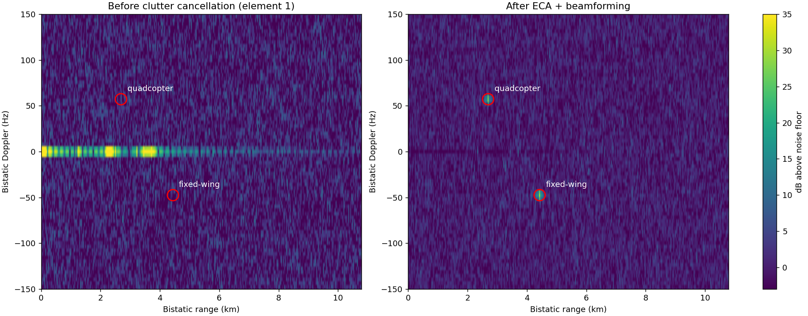
  <br><sub><b>Range-Doppler map.</b> Left: the direct signal and ground clutter hide everything. Right: after clutter cancellation (ECA) and beamforming, both drones stand out about 25 dB above the noise.</sub>
</p>

<p align="center">
  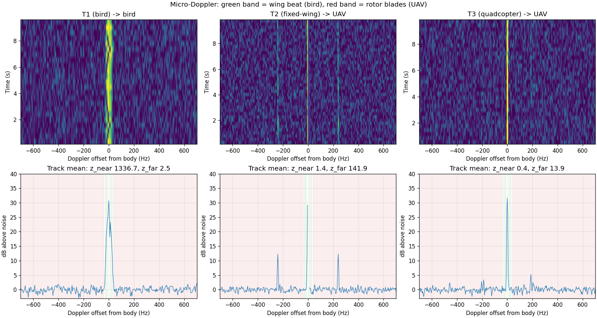
  <br><sub><b>Micro-Doppler.</b> The bird's wing beat hugs the body line. The drones show rotor or propeller lines out to ±240 Hz, so they're classified as <b>UAV</b>.</sub>
</p>

<table>
<tr>
<td width="50%">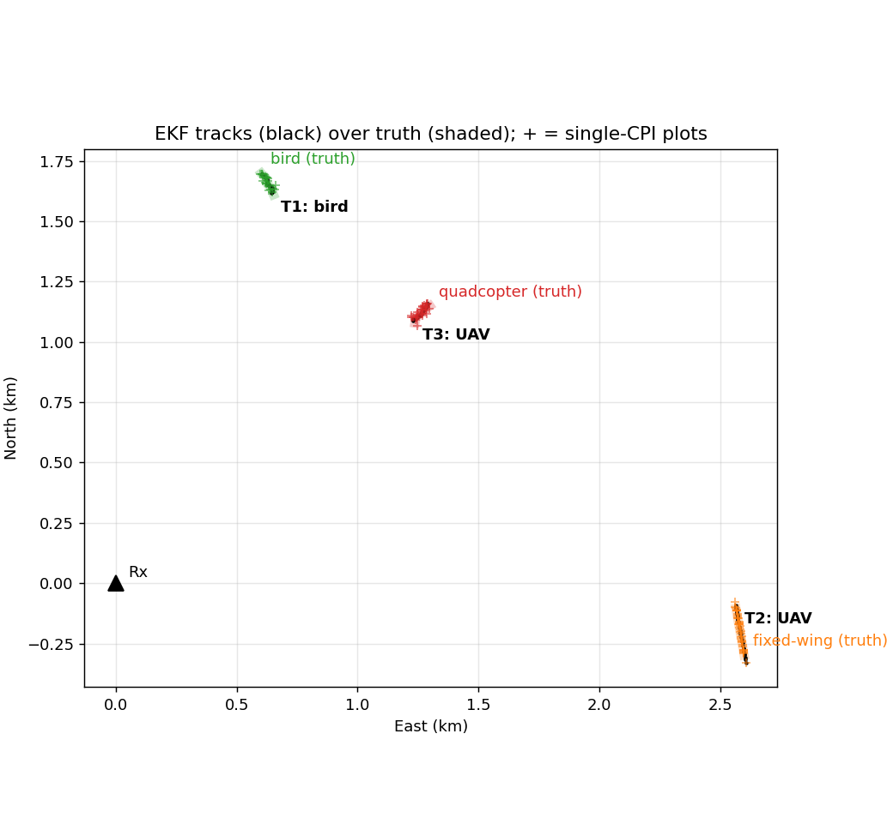<br><sub><b>Tracking:</b> an EKF tracker over 10 s. Each track is labelled bird or UAV.</sub></td>
<td width="50%">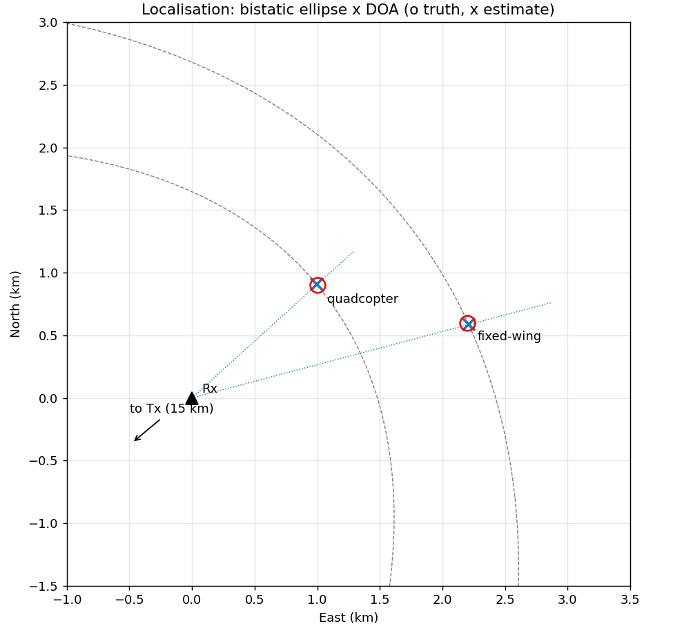<br><sub><b>Localisation:</b> the bistatic range ellipse crossed with the measured direction of arrival.</sub></td>
</tr>
</table>

---

## Receiver hardware

There are three custom boards per receiver stack, all designed in **OpenSchematic / OpenBoard**. Each band has one A2 front end and two stacks.

<table>
<tr>
<td width="50%">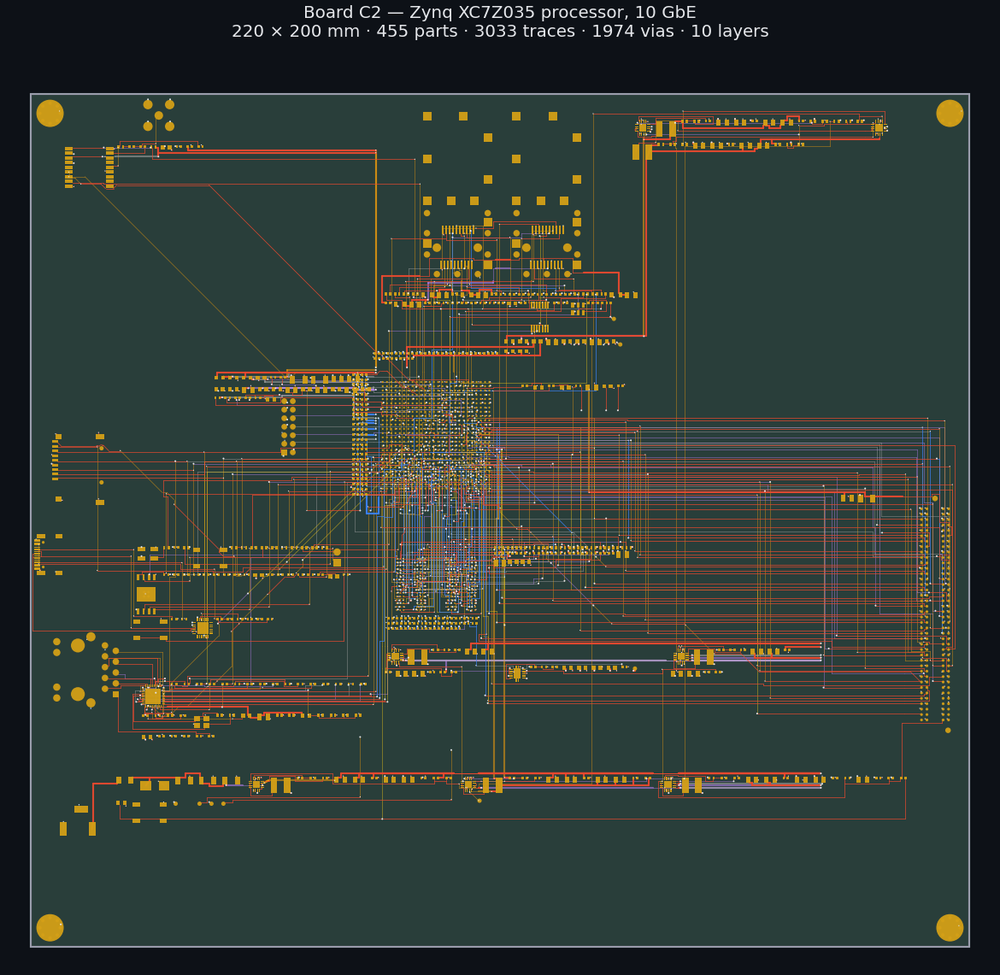</td>
<td width="50%">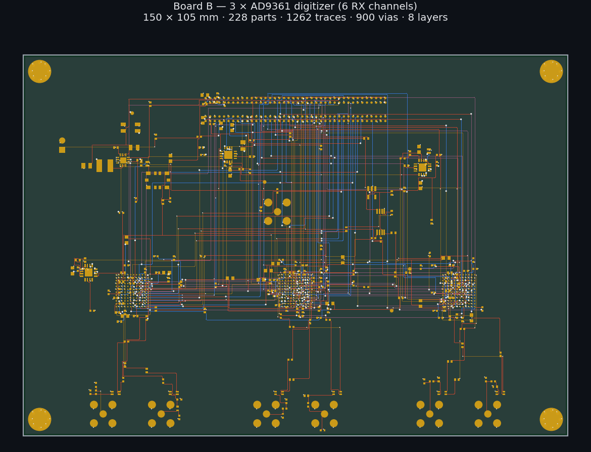</td>
</tr>
<tr>
<td><b>Board C2:</b> Zynq XC7Z035, DDR3, SFP+ 10 GbE, FMC to Board B. 10 layers, 0 DRC errors.</td>
<td><b>Board B:</b> three AD9361 transceivers giving 6 phase-coherent receive channels, with a shared clock and multi-chip sync.</td>
</tr>
<tr>
<td width="50%">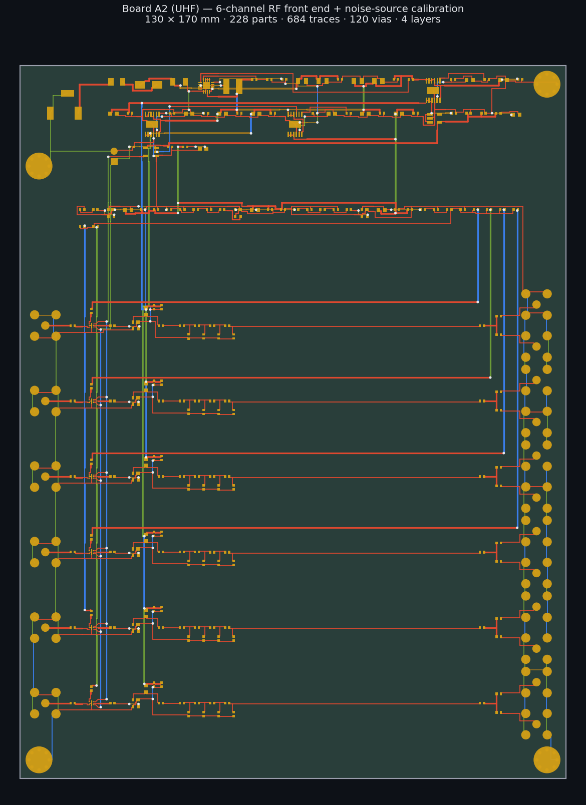</td>
<td width="50%">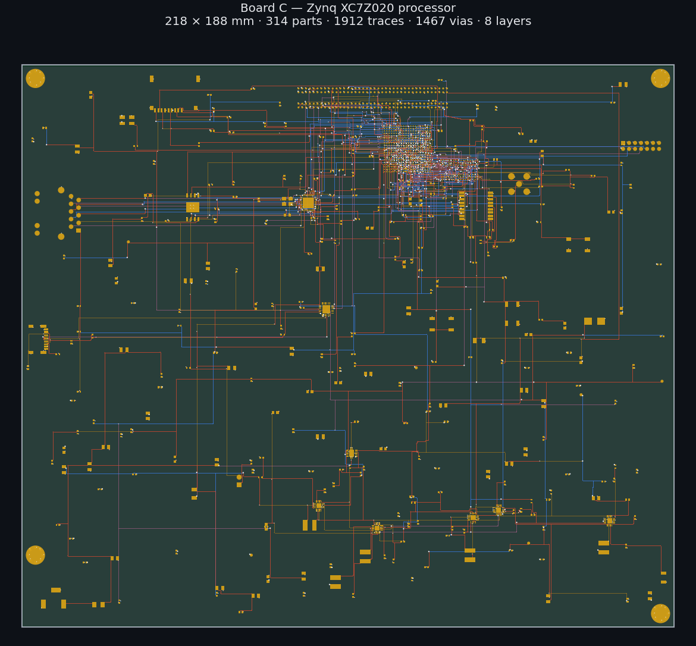</td>
</tr>
<tr>
<td><b>Board A2:</b> six-channel RF front end with LNAs, band filters and a noise source that calibrates all channels' phase. Built in four band versions.</td>
<td><b>Board C:</b> Zynq XC7Z020, the lower-cost processor for TV-only stacks.</td>
</tr>
</table>

Schematics, layouts, Gerbers, BOMs and pick-and-place files are in `hardware/board_*/` and `hardware/release/`. See **[hardware/HARDWARE.md](hardware/HARDWARE.md)**.

---

## Firmware: FPGA + ARM

| Block | What it does | Verified |
|---|---|---|
| `canceller.v` | 128-tap complex direct-signal canceller per channel; taps loaded from the host | bit-exact against the Python model, 0 mismatches |
| `md_engine.v` | micro-Doppler engine: beamforms and range-gates up to 8 targets the host is tracking, continuously | 0 mismatches |
| `stream_pack.v` | packs reference + residual into UDP-sized packets | 0 mismatches |
| `ad_merge.v` | aligns the three AD9361 clock domains | 955 samples aligned, no loss |
| `md_classifier.py` (ARM) | Hann spectra → UAV / bird / no signal | false-alarm rate 0.25% |

**End-to-end simulation:** a near quadcopter is classified **UAV** in 4 s and a bird **bird**; the canceller removes 43.6 dB of direct signal. The Board C build uses 67% of the XC7Z020's DSP slices. Details are in **[firmware/FIRMWARE.md](firmware/FIRMWARE.md)**.

---

## Antennas and radome

<table>
<tr>
<td width="50%"></td>
<td width="50%">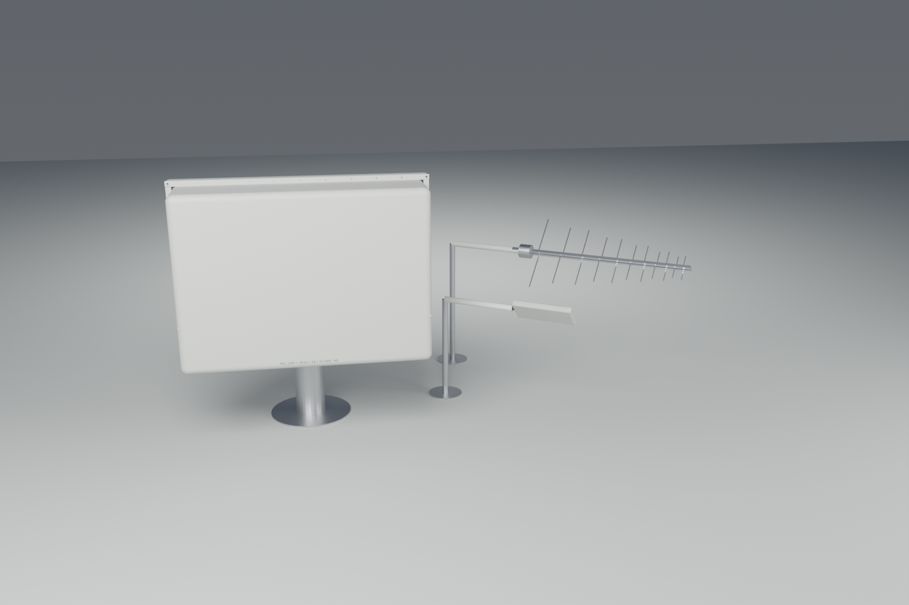</td>
</tr>
<tr>
<td><b>One radome, four bands:</b> 4 UHF bowties on top and 3 × 4 printed dipoles below, all tilted +45° to match the cell sites' polarization.</td>
<td><b>The antenna set:</b> the combined radome, plus log-periodic reference antennas for UHF (aluminium) and 1.7–4 GHz (PCB).</td>
</tr>
</table>

<table>
<tr>
<td width="50%">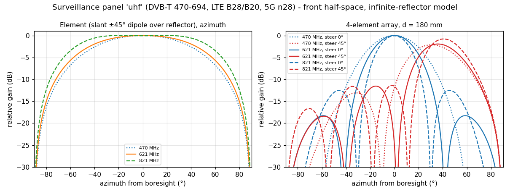</td>
<td width="50%">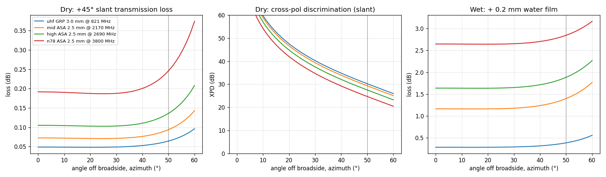</td>
</tr>
<tr>
<td><b>Array patterns:</b> beam steered across ±50°.</td>
<td><b>Radome loss:</b> under 0.45 dB dry in every band; a rain film costs up to 2.9 dB at n78.</td>
</tr>
</table>

<p align="center">
  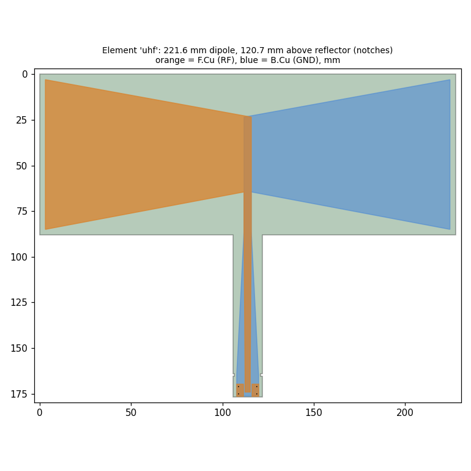
  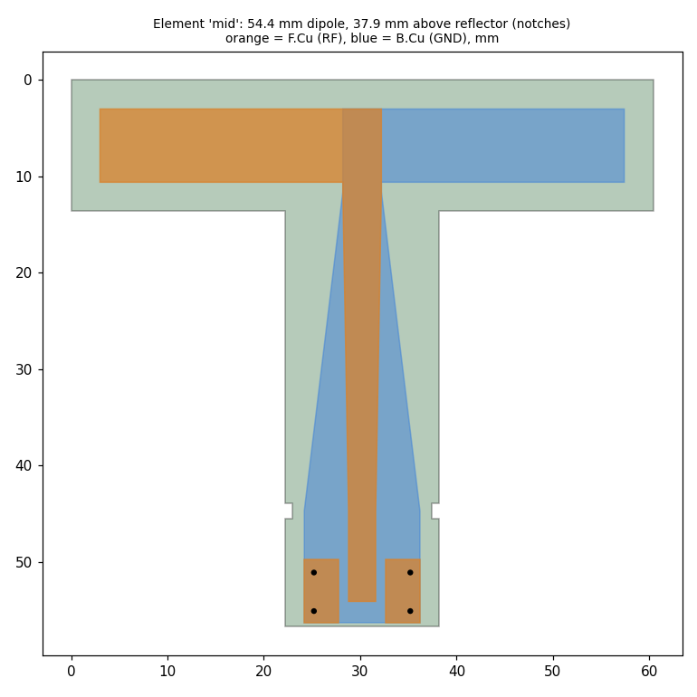
  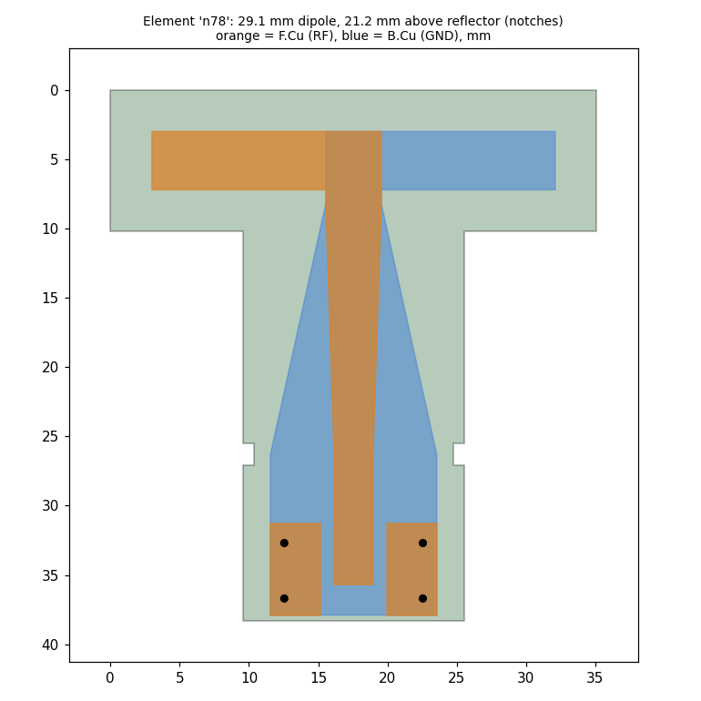
  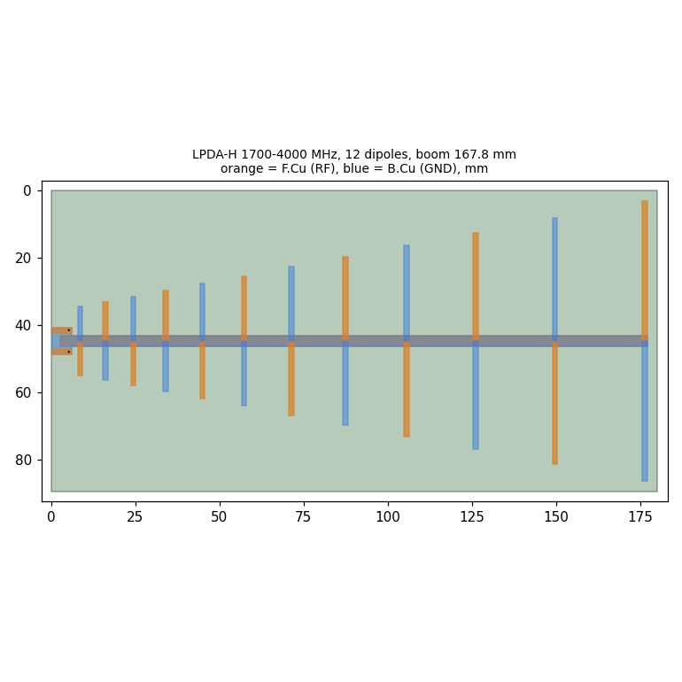
  <br><sub>Antenna PCBs: printed dipoles with a built-in balun, and the printed LPDA. All have fab files.</sub>
</p>

See **[ANTENNA.md](hardware/antenna/ANTENNA.md)** and **[RADOME.md](hardware/antenna/RADOME.md)**.

---

## Enclosure

<table>
<tr>
<td width="50%"></td>
<td width="50%">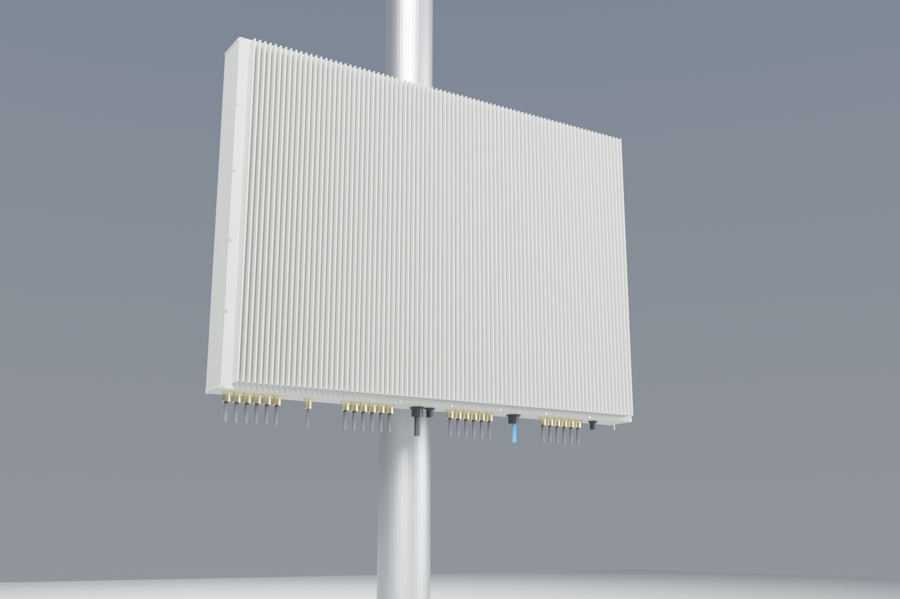</td>
</tr>
<tr>
<td><b>Inside:</b> four band columns. Each has its A2 at the bottom and two receiver stacks above. 20 boards, about 158 W.</td>
<td><b>Outside:</b> cast aluminium, IP65, finned cover. Underneath: 24 antenna inputs, one 12-fibre connector and 48 V DC.</td>
</tr>
</table>

See **[ENCLOSURE.md](hardware/enclosure/ENCLOSURE.md)**.

---

## Run it

```bash
pip install -r requirements.txt
python -m pcl.link_budget        # detection-range table
python -m pcl.data_rate          # receiver-to-host data budget
python run_demo.py               # one CPI: detection + localisation -> output/
python run_tracking_demo.py      # 10 s, 3 targets: tracking + drone/bird classification (~5 min)
python firmware/sim/run_tests.py # FPGA HDL vs bit-true models (needs Icarus Verilog)
python firmware/sim/test_e2e.py 4  # scene -> FPGA model -> on-board classifier
```

The Blender models re-render with:

```bash
blender -b -P hardware/antenna/radome_blender.py
blender -b -P hardware/enclosure/enclosure_all_blender.py
```

---

## Repository layout

| Path | Contents |
|---|---|
| `docs/` | design document, images |
| `pcl/` | signal-processing simulation: geometry, signal model, ECA, cross-ambiguity, CFAR, DOA, EKF tracking, micro-Doppler classifier |
| `firmware/hdl/` | Verilog: canceller, micro-Doppler engine, stream packer, AXI core, clock-domain merge |
| `firmware/model/`, `firmware/sim/` | bit-true Python models and testbenches |
| `firmware/ps/` | ARM side: node daemon, classifier, radio control, UDP streamer |
| `firmware/vivado/`, `firmware/linux/` | Vivado block design and pin constraints, Linux device-tree overlay |
| `hardware/board_a2/`, `board_b*/`, `board_c*/` | board designs: schematics, layouts, fab files |
| `hardware/antenna/` | antenna design, PCBs, radome, renders |
| `hardware/enclosure/` | receiver enclosure models and renders |
| `hardware/tools/` | layout, routing, DRC and rendering scripts |

**Not included:** Freerouting and a Java runtime, and the vendor 3D component models (`hardware/lib/prc.3dshapes`). Fetch them separately if needed.

---

## Status

This is a **design and simulation project**. Nothing has been built or tested on real hardware yet, and every RF figure is calculated, not measured.

| Done | Still to do |
|---|---|
| Signal processing simulated end to end | Build and bring up the boards |
| Board layouts at 0 DRC errors, fab files | Vivado build and timing closure |
| FPGA blocks verified bit-exact in simulation | Linux device tree on hardware; C streamer on the board |
| Antenna, radome and enclosure concepts | Antenna tests on a VNA; radome and enclosure CAD |

---

<p align="center">
  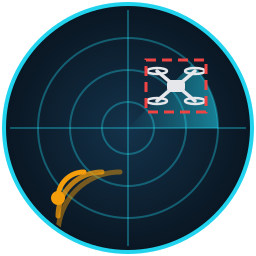<br>
  <sub>© 2026 ajisrawi. All rights reserved. No licence is granted.</sub>
</p>
