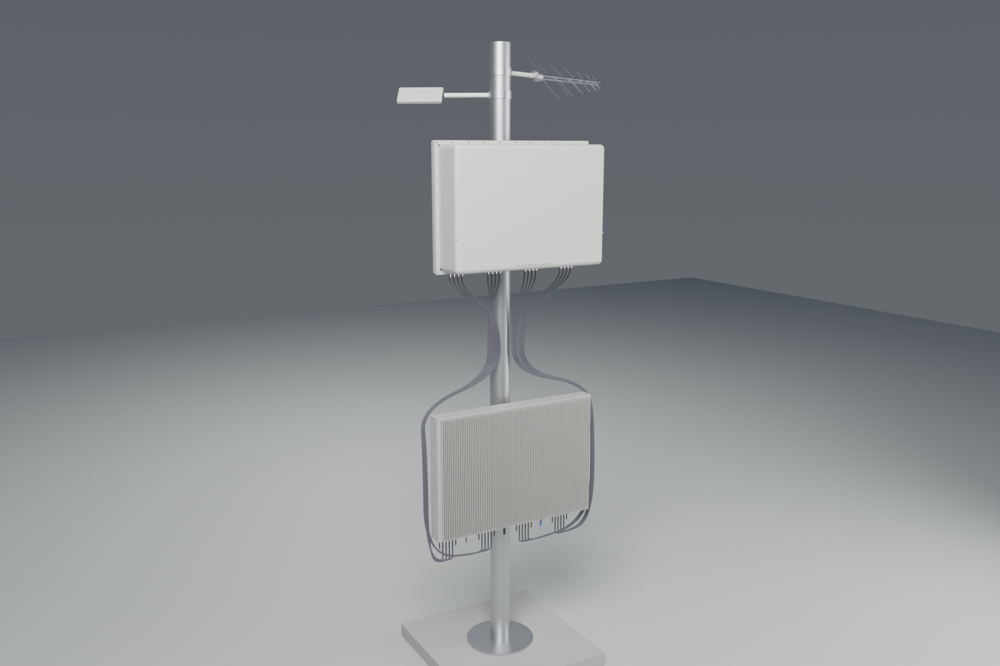
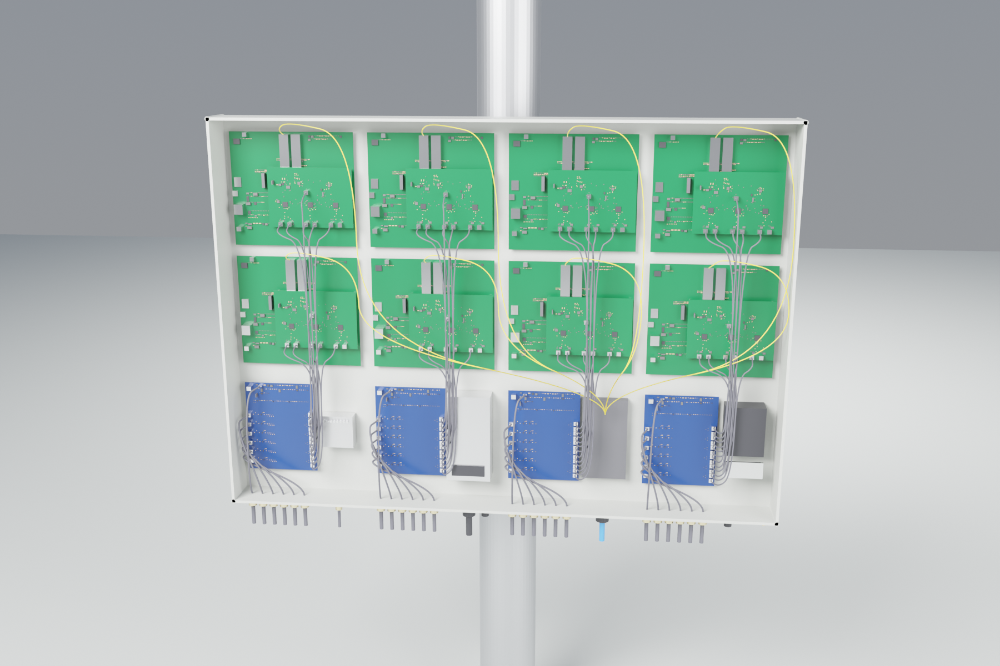
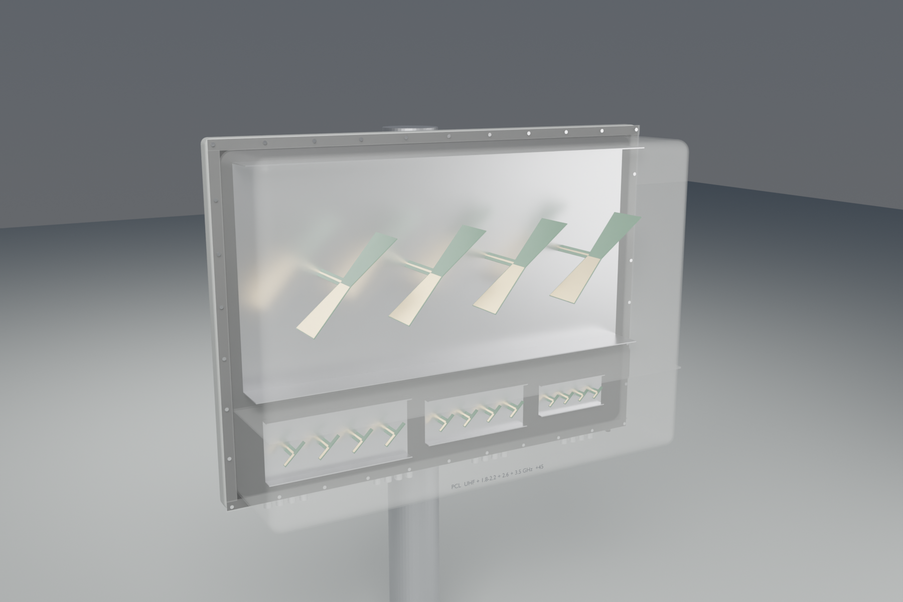

# Passive Radar for Counter-Drone

A passive radar that detects small drones from their reflections of signals already in the air. It uses **digital TV (DVB-T), 4G LTE and 5G NR at the same time**:
- **TV:** high-power transmitters give range.
- **4G/5G:** wide bandwidths give range resolution.
- **On-board micro-Doppler:** FPGA processing tells drones (rotor lines) from birds (wing-beat).



## What's here

| Part | Where | Status |
|---|---|---|
| Design document: requirements, illuminators, link budget, architecture, deployment | [docs/DESIGN.md](docs/DESIGN.md) | done |
| Signal-processing simulation: clutter cancellation, cross-ambiguity, beamforming, CFAR, tracking, classification | `pcl/`, `run_demo.py`, `run_tracking_demo.py` | runs |
| Receiver hardware: Board A2 RF front end (4 band builds), Board B digitizer (3 × AD9361), Board C / C2 Zynq processor | `hardware/board_*`, [hardware/HARDWARE.md](hardware/HARDWARE.md) | schematics, PCB layouts, fab files |
| FPGA + ARM firmware: direct-signal canceller, micro-Doppler engine, streaming, Linux daemon | `firmware/`, [firmware/FIRMWARE.md](firmware/FIRMWARE.md) | HDL verified in simulation; Vivado/Linux not yet run |
| Antennas: +45° slant printed-dipole arrays per band, LPDA references, PCBs | `hardware/antenna/`, [ANTENNA.md](hardware/antenna/ANTENNA.md) | designed from formulas, PCB fab files |
| Antenna radome: all four bands in one | [RADOME.md](hardware/antenna/RADOME.md) | concept + Blender model |
| Receiver enclosure: whole site in one box | [ENCLOSURE.md](hardware/enclosure/ENCLOSURE.md) | concept + Blender model |

**Status:** a design and simulation project. Nothing here has been built or tested on real hardware yet. Every RF figure is calculated, not measured.

<p>


</p>

**Not included:**
- Freerouting and a Java runtime, which some routing scripts call.
- The vendor 3D component models (`hardware/lib/prc.3dshapes`).

Fetch them separately if you need them.

**Licence:** none. All rights reserved.

## Run

```bash
pip install -r requirements.txt
python -m pcl.link_budget   # detection-range table
python -m pcl.data_rate     # receiver-to-host Ethernet budget + sample-precision study
python run_demo.py          # single CPI: detection + localisation, figures in output/
python run_tracking_demo.py # 10 s, 3 targets: tracking + drone/bird classification (~5 min)
```

## Layout

| File | What it does |
|---|---|
| `pcl/link_budget.py` | Bistatic radar equation, SNR, max range |
| `pcl/data_rate.py` | Ethernet data-rate budget; target SNR lost to reduced sample bits, with and without FPGA cancelling |
| `pcl/geometry.py` | Bistatic range/Doppler, ellipse × DOA localisation |
| `pcl/signal_model.py` | DVB-T-like OFDM signal, multichannel array receiver |
| `pcl/processing.py` | ECA clutter cancellation, cross-ambiguity function, beamforming, CFAR, DOA |
| `pcl/micro_doppler.py` | Rotor (blade) and bird wing-beat echo models |
| `pcl/targets.py` | Moving-target trajectories and per-CPI echo parameters |
| `pcl/tracking.py` | EKF multi-target tracker (bistatic range / Doppler / azimuth) |
| `pcl/classify.py` | Micro-Doppler drone vs bird classifier |
| `run_demo.py` | Two-drone scenario, one CPI |
| `run_tracking_demo.py` | Quadcopter + fixed-wing + bird over 40 CPIs |
| `hardware/` | Custom 3-board receiver: schematics, placed PCBs, BOMs, EasyEDA import packages. See [hardware/HARDWARE.md](hardware/HARDWARE.md) |
